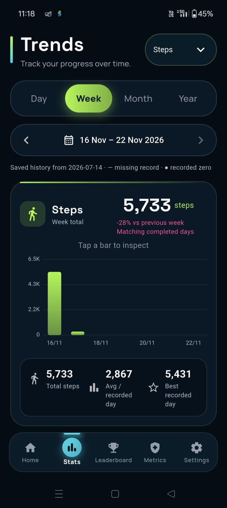
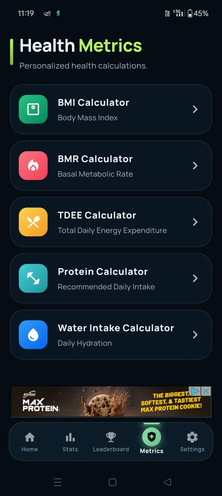
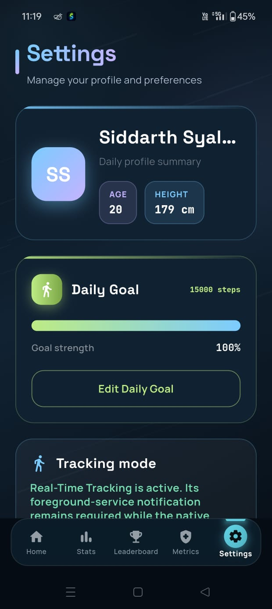
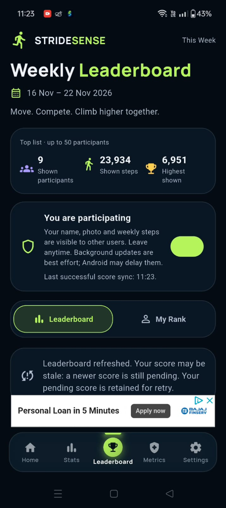
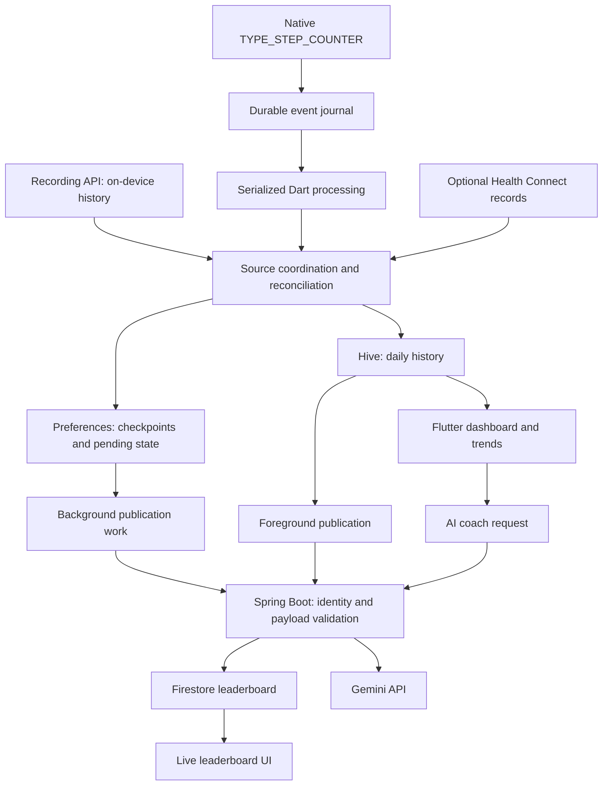

  

  
  
  
  

  **A shipped Android fitness app. A full-stack engineering project. Built around real mobile constraints.**

  Step tracking · GPS walks · Activity trends · Weekly leaderboards · AI coaching

## At a glance

**StrideSense** brings daily activity, walking sessions and fitness guidance into one Flutter application published on Google Play. Native Android integrations handle tracking; local storage preserves activity; a Spring Boot backend supports validated leaderboard publication and Gemini-powered coaching.

This is the **public product and engineering showcase**. Application and backend source remain private. Built and maintained by [Siddarth Syal](https://github.com/siddarth2103).

[Product tour](#product-tour) · [Architecture](#architecture) · [Engineering decisions](#engineering-decisions) · [Google Play](https://play.google.com/store/apps/details?id=com.siddarth.stridesense)

### The 30-second overview

| Product | Engineering |
|---|---|
| Published Android app with an integrated fitness dashboard | Flutter interface connected to native Kotlin services |
| Choice of Battery Saver and Real-Time tracking | Source-specific recording, validation and reconciliation |
| Personal history and opt-in weekly competition | Local persistence, durable pending work and authenticated APIs |
| GPS walks and contextual AI guidance | Location processing and server-side Gemini integration |

## Why build this?

A fitness dashboard looks simple until the app is closed, the phone reboots, a sensor callback arrives late, or a user switches accounts. StrideSense explores that gap between a working demo and a shipped mobile product.

The product goal is a clear view of daily activity with optional deeper tools—not a requirement to understand sensors, storage or cloud infrastructure. The engineering goal is to keep those systems coordinated while making unavailable, delayed and unverified states understandable.

### Feature map

- **Track:** phone-step recording, selectable tracking modes and optional Health Connect integration.
- **Understand:** interactive activity charts, daily goals, streaks and estimated fitness metrics.
- **Explore:** manually started GPS walks with distance, speed and session summaries.
- **Compete:** account-based opt-in, weekly rankings, personal rank and publication-status feedback.
- **Ask:** AI coaching informed by activity context, delivered through a backend rather than an embedded provider key.
- **Personalize:** profile inputs, daily targets, backgrounds and tracking preferences.

## Product tour

Real app screenshots—not design mockups. Values reflect individual sessions; advertisements and sync-status messages are preserved as captured.

### Daily activity, trends and health tools

<table>
  <tr>
    <td align="center" width="33%"> <strong>Daily dashboard</strong> Steps, progress and tracking controls</td>
    <td align="center" width="33%"> <strong>Activity trends</strong> Day, week, month and year views</td>
    <td align="center" width="33%"> <strong>Health metrics</strong> Formula-based fitness estimates</td>
  </tr>
</table>

### Walking sessions and personal insights

<table>
  <tr>
    <td align="center" width="33%"> <strong>Live Walk</strong> GPS session tracking and activity insights</td>
    <td align="center" width="33%"> <strong>Weekly summary</strong> Activity across recorded days</td>
    <td align="center" width="33%"> <strong>Your preferences</strong> Profile, goals and tracking modes</td>
  </tr>
</table>

### Weekly competition

<table>
  <tr>
    <td align="center" width="50%"> <strong>Explicit participation</strong> Join or leave, with score-sync feedback</td>
    <td align="center" width="50%"> <strong>Weekly rankings</strong> Podium, participant list and personal rank</td>
  </tr>
</table>

## Architecture

| Layer | Implementation | Responsibility |
|---|---|---|
| Experience | Flutter, Dart | Home, trends, metrics, walks, coaching and settings |
| Battery Saver | Google Play services `FitnessLocal` Recording API | On-device step recording and day-scoped reads |
| Real-Time | Kotlin, `SensorManager`, `TYPE_STEP_COUNTER`, health foreground service | Native sensor callbacks and ongoing tracking status |
| Optional health source | Health Connect | Permission-controlled access to available step records |
| Processing | Native journal, serialized Dart processing, source reconciliation | Validate readings, retain pending work and avoid overlapping totals |
| Local data | SharedPreferences, Hive | Tracking checkpoints, pending state and daily history |
| Identity and cloud | Firebase Authentication, Cloud Firestore | Account identity, cloud records and leaderboard streams |
| Backend | Java, Spring Boot, Cloud Run, Firebase App Check | Authenticated leaderboard publication and AI request handling |
| Coaching | Gemini API through the backend | Activity-aware, non-medical fitness guidance |
| Walks | GPS, Google Maps | User-started walking sessions |
| Monetization | AdMob with Unity mediation | Integrated ad delivery |

**Data flow:** selected activity source → validation and reconciliation → local state/history → UI → deferred synchronization.

In Real-Time mode, native callbacks are durably journaled before Dart processing. Recording API and Health Connect use day-scoped records. Source transitions preserve verified activity without simply adding overlapping raw totals.

### System boundaries

The diagram summarizes responsibilities, not a promise that every write follows a single synchronous chain. GPS Live Walk sessions use a separate location-processing path.

### Tracking modes are different contracts

| Mode | Who manages collection? | What StrideSense processes | Important boundary |
|---|---|---|---|
| Battery Saver | Google Play services | Recorded local-day step aggregates | Readiness and aggregate latency are separate from UI refresh |
| Real-Time | StrideSense's native sensor service | Cumulative sensor callbacks | Direct listening still depends on Android lifecycle and sensor delivery |
| Health Connect | Available health-data providers/system capabilities | Permission-controlled step records | Useful data depends on support, permissions and available records |

Only the selected authoritative source determines the reconciled total for its scope. A mode switch is a data-boundary operation, not permission to add two measurements of the same walk.

### From raw event to daily activity

1. **Capture:** the native layer receives a cumulative sensor reading and its timing/context.
2. **Persist:** a journal records the event before Flutter processing is required.
3. **Validate:** processing checks ownership, date, boot, installation and source context.
4. **Reconcile:** baselines and checkpoints translate raw readings into daily activity; ambiguous evidence is not blindly credited.
5. **Commit:** accepted state and pending synchronization information are saved.
6. **Present:** the interface consumes committed activity; cloud publication follows independently.

The native baseline model is conceptually `daily steps ≈ cumulative reading − baseline`, with additional checks for resets, replay, source changes and restored state. It is not used as a shortcut for every source.

### Persistence and synchronization

| State | Purpose |
|---|---|
| Native journal | Retain already-captured readings until processing |
| SharedPreferences | Small checkpoints, account/date context and pending snapshots |
| Hive | Structured daily history used by statistics |
| Firestore | Cloud-backed records and live leaderboard reads |

Leaderboard participation is account-scoped; weekly scores are week-scoped. Personal publication and list retrieval are treated independently, so a successful list refresh does not falsely imply the user's latest local score was accepted. Pending snapshots are retained for eligible retry, and exact-token checks protect newer work from being cleared by an older request.

Background work uses scheduling and bounded retry rather than requiring the Flutter UI to remain active. Network availability, authentication, App Check, backend validation and Android scheduling all affect eventual delivery.

## Engineering decisions

- **Capture independently of the UI.** A durable journal separates captured sensor events from Flutter availability; acknowledgement follows processing.
- **Keep one native sensor owner.** Service lifecycle and source transitions are coordinated rather than spawning competing listeners.
- **Treat time as part of correctness.** Date, timezone, boot and installation metadata matter. An ambiguous cumulative batch spanning midnight cannot reveal every step's individual timestamp.
- **Persist before synchronizing.** Checkpoints and daily history support offline use; durable pending publication supports later retries.
- **Separate membership from scores.** Account-level participation is distinct from Monday-based weekly rankings. Server refresh and personal publication have separate outcomes.
- **Bound recovery work.** Runtime budgets, backoff, subscription readiness and wake-lock cleanup target unnecessary background processing.
- **Protect account boundaries.** Owner, installation and source identity are checked before activity is committed or published.
- **Test lifecycle races.** Regression coverage targets delayed initialization, replay, duplicates, handoffs and stale account/week results.

### Selected engineering case studies

<strong>Cold-start ordering: configure the consumer before enabling the producer</strong>

A native service can receive events before a fresh Flutter installation has registered its background callback. Startup coordination now configures that callback first, guards native launches when it is absent, and checks for unread journal work when configuration completes. This separates durable capture from processor readiness without resetting saved totals.

<strong>Background resource use: recovery needs a budget</strong>

An error path that repeatedly refreshes an idle timestamp can prevent a processor from stopping. Bounded failure counts, backoff and runtime limits address that lifecycle problem. Wake-lock ownership and shutdown cleanup are separate concerns: releasing a lock does not by itself prove a busy loop stopped.

<strong>Midnight: a cumulative count is not per-step history</strong>

A raw increase spanning midnight does not reveal how many steps belong to either day. The native path uses boundary evidence where available and conservative treatment otherwise. Day-scoped recorded history provides a different evidence model. This is an explicit correctness trade-off rather than a claim of perfect attribution.

<strong>Leaderboard refresh: reading and writing are different outcomes</strong>

The interface previously tied applying fresh server entries to successful personal publication. The presentation flow now treats them separately: valid server results can refresh the list while an independent warning explains that a personal score remains pending. Account/week guards and stream-versus-refresh ordering protect against stale asynchronous results.

## Security and privacy boundaries

- **Account scope:** guest and authenticated state are separated; delayed work must still belong to the initiating account.
- **Backend boundary:** authenticated leaderboard publication is validated server-side; client-side checks are not treated as a security boundary.
- **App Check:** app-attestation tokens support request validation, but do not establish that a physical step count is perfectly accurate.
- **Provider credentials:** Gemini requests are mediated by the backend; provider secrets do not belong in the Flutter bundle or this showcase.
- **Explicit competition:** participation controls whether profile/ranking information is shared through the leaderboard.
- **Permission-aware tracking:** physical-activity, notification, health-data and location access have distinct roles.
- **Scoped diagnostics:** bounded pipeline and recovery diagnostics support investigation without publishing credentials or full personal-state dumps.

## Quality strategy

The private implementation includes Flutter behavioral tests, Android JVM policy tests and backend tests. Coverage is organized around failure conditions, not just successful screens:

| Area | Example regression scenarios |
|---|---|
| Startup | Missing callback, delayed configuration, permission ordering and unread backlog |
| Sensor processing | Duplicate/reordered readings, counter resets and deferred evidence |
| Identity | Account switches, restored installation state and stale asynchronous results |
| Source transitions | Baseline preservation, subscription recovery and overlapping aggregates |
| Background lifecycle | Retry exhaustion, processor shutdown and wake-lock cleanup |
| Leaderboard | Pending-token races, membership state, week rollover and refresh/listener ordering |
| Presentation | Chart interaction, historical availability and distinct sync/read failures |

Static analysis, release lint and build/signature checks complement those tests. This public repository does not contain the private test suites or a public CI pipeline; no live coverage percentage or continuously passing build badge is claimed.

Physical-device scenarios remain a separate layer of evidence: sensor delivery, screen-off operation, OEM process kills, reboot, overnight rollover and battery behavior cannot be established by mocked tests alone.

## Metrics: measurements versus estimates

- **Daily distance:** step count multiplied by height-based estimated step length.
- **Live Walk distance:** accumulated accepted GPS segments using the Haversine formula.
- **Calories and active minutes:** estimates derived from distance and profile assumptions.
- **BMI, BMR and TDEE:** formula-based calculators using user inputs; not diagnosis or medical advice.
- **Fitness score:** an application-defined activity indicator, not a clinical assessment.

Keeping GPS distance separate from step-derived distance avoids directly adding two measurements of the same walk.

### Platform boundaries

Android and OEM restrictions can delay or stop background work. Periodic jobs are best-effort, not an exact 15-minute promise. Sensor batching and source latency affect display timing. Distance, calories, active minutes and health calculations are estimates—not medical measurements. Automated regressions complement physical-device verification; they do not guarantee universal reliability.

## AI coach & visual identity

<table>
  <tr>
    <td align="center" width="33%"> <strong>StrideSense</strong></td>
    <td align="center" width="33%"> <strong>AI Health Coach</strong></td>
    <td align="center" width="33%"> <strong>Fitness coach</strong></td>
  </tr>
</table>

## What this project demonstrates

End-to-end product delivery: Flutter UI development, Kotlin platform integration, lifecycle-aware background processing, local persistence, Firebase integration, Java/Spring Boot APIs, cloud deployment and production debugging.

The engineering challenge is not just showing a number—it is coordinating sensors, asynchronous processing, storage, identity and synchronization under mobile lifecycle constraints.

### Technical discussion guide

For interviews or engineering review, this project provides concrete discussion points:

1. Why a durable journal is different from a UI event stream.
2. How replay can be safe without blindly counting duplicates.
3. Why device counters and account totals need different scopes.
4. How startup ordering affects fresh installations differently from established ones.
5. Why retries need eligibility checks, backoff and termination conditions.
6. Why an accepted server write, a refreshed list and a current local total are separate facts.
7. Where mobile-platform guarantees end—and how the product communicates that boundary.

## Repository guide

| Path | Contents |
|---|---|
| `README.md` | Product tour and engineering case study |
| `assets/` | Current app screenshots, brand artwork and supporting graphics |

This is not a runnable source distribution. There are no setup commands or sample credentials because the production implementation is intentionally not included. Use the Play listing to experience the product and this README to explore its design decisions.

## Try StrideSense

[**Download on Google Play →**](https://play.google.com/store/apps/details?id=com.siddarth.stridesense)

This showcase intentionally excludes application source, backend source, credentials, signing material and production configuration. The implementation is proprietary; no open-source license is implied.

---

Built and shipped by **[Siddarth Syal](https://github.com/siddarth2103)**.
