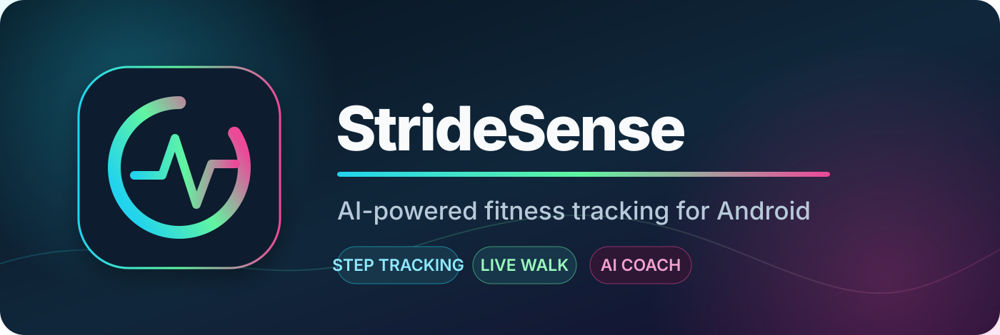
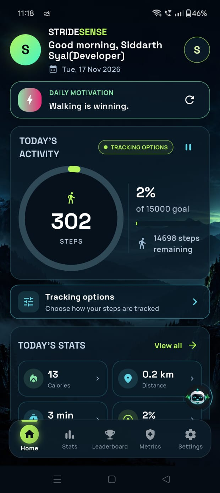
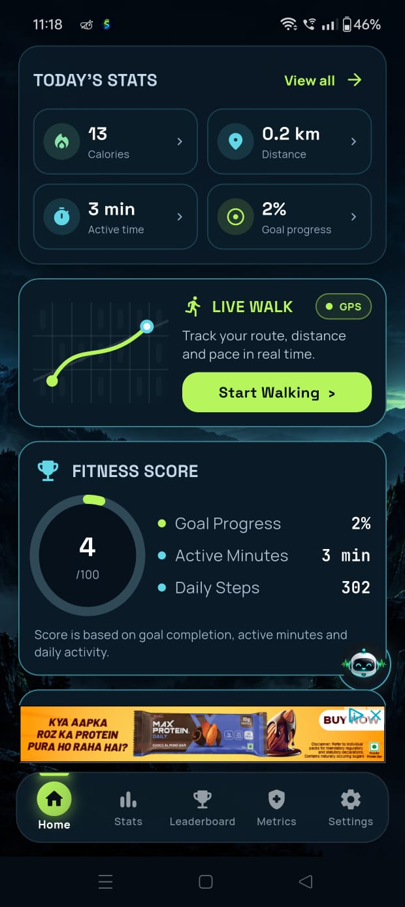
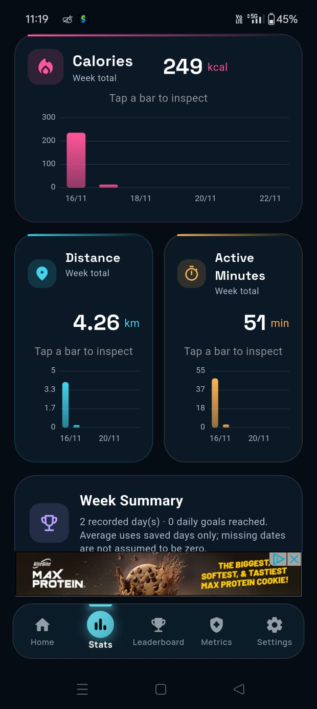
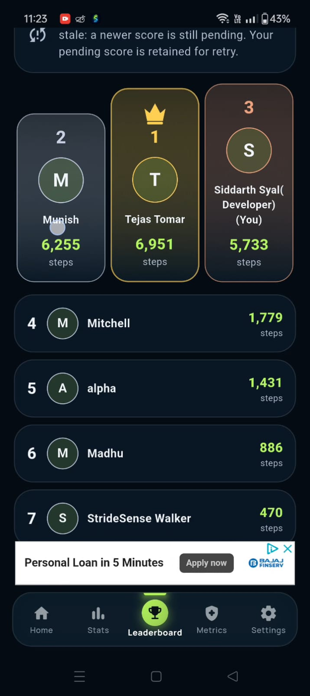

  

  
  
  
  

  **A shipped Android fitness app. A full-stack engineering project. Built around real mobile constraints.**

  Step tracking · GPS walks · Activity trends · Weekly leaderboards · AI coaching

## At a glance

**StrideSense** brings daily activity, walking sessions and fitness guidance into one Flutter application published on Google Play. Native Android integrations handle tracking; local storage preserves activity; a Spring Boot backend supports validated leaderboard publication and Gemini-powered coaching.

This is the **public product and engineering showcase**. Application and backend source remain private. Built and maintained by [Siddarth Syal](https://github.com/siddarth2103).

[Product tour](#product-tour) · [Architecture](#architecture) · [Engineering decisions](#engineering-decisions) · [Google Play](https://play.google.com/store/apps/details?id=com.siddarth.stridesense)

## Product tour

Real app screenshots—not design mockups. Values reflect individual sessions; advertisements and sync-status messages are preserved as captured.

### Daily activity, trends and health tools

<table>
  <tr>
    <td align="center" width="33%"> <strong>Daily dashboard</strong> Steps, progress and tracking controls</td>
    <td align="center" width="33%"> <strong>Activity trends</strong> Day, week, month and year views</td>
    <td align="center" width="33%"> <strong>Health metrics</strong> Formula-based fitness estimates</td>
  </tr>
</table>

### Walking sessions and personal insights

<table>
  <tr>
    <td align="center" width="33%"> <strong>Live Walk</strong> GPS session tracking and activity insights</td>
    <td align="center" width="33%"> <strong>Weekly summary</strong> Activity across recorded days</td>
    <td align="center" width="33%"> <strong>Your preferences</strong> Profile, goals and tracking modes</td>
  </tr>
</table>

### Weekly competition

<table>
  <tr>
    <td align="center" width="50%"> <strong>Explicit participation</strong> Join or leave, with score-sync feedback</td>
    <td align="center" width="50%"> <strong>Weekly rankings</strong> Podium, participant list and personal rank</td>
  </tr>
</table>

## Architecture

| Layer | Implementation | Responsibility |
|---|---|---|
| Experience | Flutter, Dart | Home, trends, metrics, walks, coaching and settings |
| Battery Saver | Google Play services `FitnessLocal` Recording API | On-device step recording and day-scoped reads |
| Real-Time | Kotlin, `SensorManager`, `TYPE_STEP_COUNTER`, health foreground service | Native sensor callbacks and ongoing tracking status |
| Optional health source | Health Connect | Permission-controlled access to available step records |
| Processing | Native journal, serialized Dart processing, source reconciliation | Validate readings, retain pending work and avoid overlapping totals |
| Local data | SharedPreferences, Hive | Tracking checkpoints, pending state and daily history |
| Identity and cloud | Firebase Authentication, Cloud Firestore | Account identity, cloud records and leaderboard streams |
| Backend | Java, Spring Boot, Cloud Run, Firebase App Check | Authenticated leaderboard publication and AI request handling |
| Coaching | Gemini API through the backend | Activity-aware, non-medical fitness guidance |
| Walks | GPS, Google Maps | User-started walking sessions |
| Monetization | AdMob with Unity mediation | Integrated ad delivery |

**Data flow:** selected activity source → validation and reconciliation → local state/history → UI → deferred synchronization.

In Real-Time mode, native callbacks are durably journaled before Dart processing. Recording API and Health Connect use day-scoped records. Source transitions preserve verified activity without simply adding overlapping raw totals.

## Engineering decisions

- **Capture independently of the UI.** A durable journal separates captured sensor events from Flutter availability; acknowledgement follows processing.
- **Keep one native sensor owner.** Service lifecycle and source transitions are coordinated rather than spawning competing listeners.
- **Treat time as part of correctness.** Date, timezone, boot and installation metadata matter. An ambiguous cumulative batch spanning midnight cannot reveal every step's individual timestamp.
- **Persist before synchronizing.** Checkpoints and daily history support offline use; durable pending publication supports later retries.
- **Separate membership from scores.** Account-level participation is distinct from Monday-based weekly rankings. Server refresh and personal publication have separate outcomes.
- **Bound recovery work.** Runtime budgets, backoff, subscription readiness and wake-lock cleanup target unnecessary background processing.
- **Protect account boundaries.** Owner, installation and source identity are checked before activity is committed or published.
- **Test lifecycle races.** Regression coverage targets delayed initialization, replay, duplicates, handoffs and stale account/week results.

### Platform boundaries

Android and OEM restrictions can delay or stop background work. Periodic jobs are best-effort, not an exact 15-minute promise. Sensor batching and source latency affect display timing. Distance, calories, active minutes and health calculations are estimates—not medical measurements. Automated regressions complement physical-device verification; they do not guarantee universal reliability.

## AI coach & visual identity

<table>
  <tr>
    <td align="center" width="33%"> <strong>StrideSense</strong></td>
    <td align="center" width="33%"> <strong>AI Health Coach</strong></td>
    <td align="center" width="33%"> <strong>Fitness coach</strong></td>
  </tr>
</table>

## What this project demonstrates

End-to-end product delivery: Flutter UI development, Kotlin platform integration, lifecycle-aware background processing, local persistence, Firebase integration, Java/Spring Boot APIs, cloud deployment and production debugging.

The engineering challenge is not just showing a number—it is coordinating sensors, asynchronous processing, storage, identity and synchronization under mobile lifecycle constraints.

## Try StrideSense

[**Download on Google Play →**](https://play.google.com/store/apps/details?id=com.siddarth.stridesense)

This showcase intentionally excludes application source, backend source, credentials, signing material and production configuration. The implementation is proprietary; no open-source license is implied.

---

Built and shipped by **[Siddarth Syal](https://github.com/siddarth2103)**.
