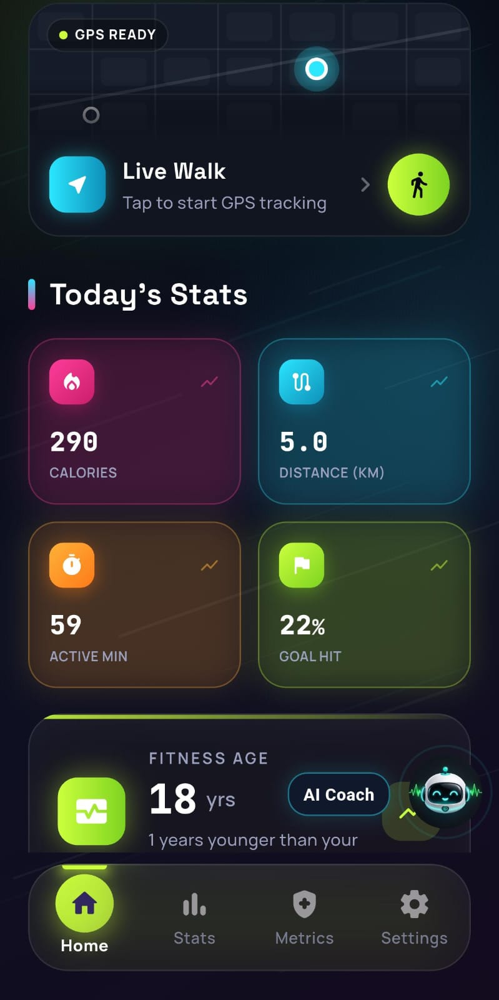
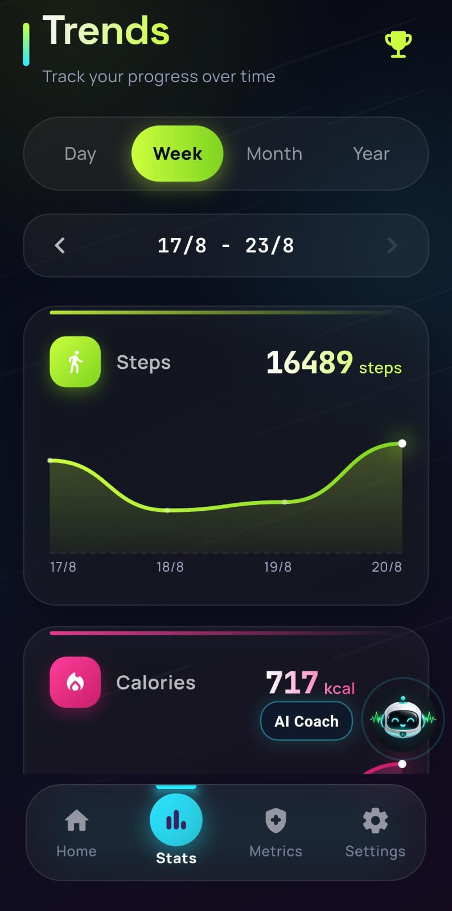
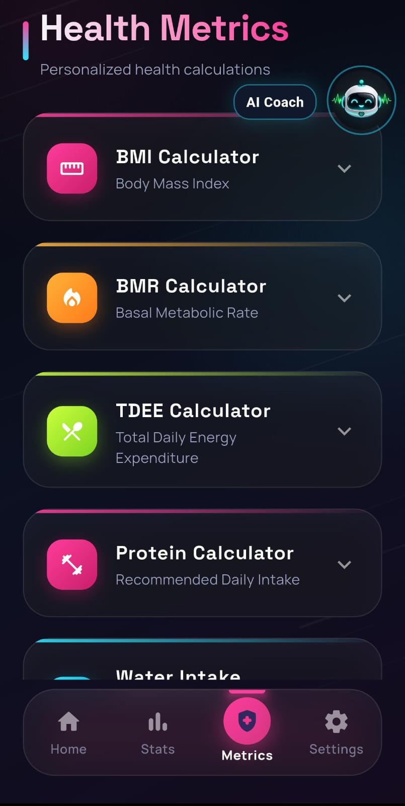
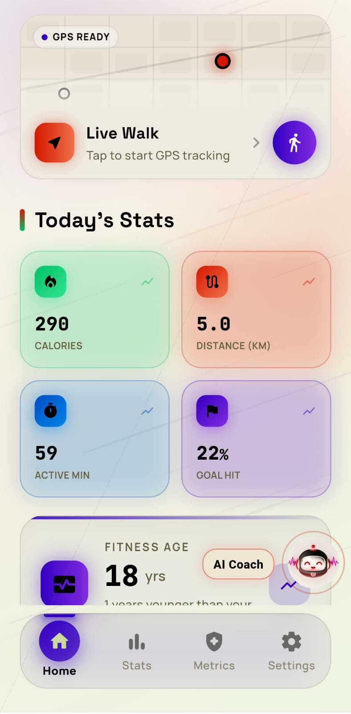
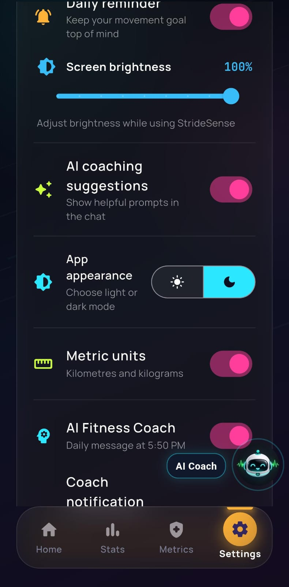
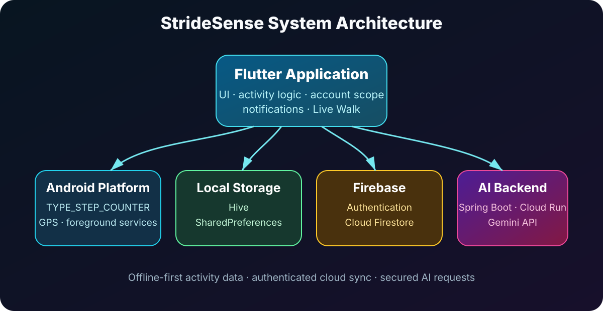

  

   

  
  
  
  

  **A production Android fitness companion combining hardware step sensing, GPS walk tracking, cloud synchronization, and AI-powered coaching.**

## About StrideSense

StrideSense is a full-stack fitness application built and launched on Google Play. It turns Android sensor data into a dependable daily activity experience while keeping manual GPS walks, cloud-backed profiles, and AI coaching within one focused product.

The project was designed around real mobile constraints: locked screens, process recreation, device reboots, midnight rollover, delayed sensor callbacks, intermittent connectivity, and multiple account scopes.

## Product highlights

- **Automatic step tracking** using Android's hardware step counter, including locked-screen operation
- **Live Walk** sessions with GPS distance, current and average speed, duration, and accuracy status
- **AI Health Coach** with activity-aware, non-medical fitness guidance
- **Goals and motivation** through streaks, statistics, reminders, and leaderboards
- **Offline-first storage** with local persistence and secure cloud synchronization
- **Account isolation** for guest and Google/Firebase profiles
- **Local-time behavior** for daily rollover, reminders, and AI usage limits
- **Accessible interface** with light and dark themes

## Product visuals

  
  &nbsp;
  
  &nbsp;
  

  
  &nbsp;
  

<table>
  <tr>
    <td align="center" width="50%">
      
       <strong>Published Android application</strong>
    </td>
    <td align="center" width="50%">
      
       <strong>StrideSense AI Health Coach</strong>
    </td>
  </tr>
</table>

  

## System architecture

  

### Technology stack

| Layer | Technologies |
|---|---|
| Mobile | Flutter, Dart, Android platform APIs |
| Activity tracking | `TYPE_STEP_COUNTER`, foreground services, background processing |
| Walk tracking | Foreground location service, GPS stream processing, Google Maps |
| Local data | Hive, SharedPreferences |
| Identity and cloud | Firebase Authentication, Cloud Firestore |
| Backend | Java, Spring Boot, Google Cloud Run |
| Intelligence | Gemini API |
| Engagement | Local notifications, goals, streaks, leaderboards |
| Monetization | Google AdMob |

## Engineering challenges

Building a step counter that works in production required more than reading a sensor value. StrideSense handles:

- Step continuity across app termination, service restart, reboot, and midnight
- Cross-isolate synchronization and protection from delayed or out-of-order events
- Monotonic daily totals without artificial step compensation
- Foreground-service recovery while keeping a single sensor owner
- GPS noise and stationary-drift filtering without suppressing genuine slow walking
- Cold-start initialization without exposing data from the wrong account
- Per-account local and cloud state during sign-in, sign-out, and account switching
- Android notification, foreground-service, privacy, and release requirements

## Privacy-conscious design

- Location access begins only after the user manually starts a Live Walk
- An ongoing Android notification is shown during active GPS tracking
- Exact coordinates and route points are not persisted or uploaded
- Saved walk records contain summary metrics only
- Health and profile data remain isolated by account scope
- Users can request account and cloud-data deletion

## Availability

StrideSense is available on Google Play:

**https://play.google.com/store/apps/details?id=com.siddarth.stridesense**

## Repository notice

This is a **public product showcase repository** created for portfolio, résumé, and professional-review purposes. It intentionally contains no application source code, backend source code, credentials, service-account files, signing material, or production configuration.

The StrideSense implementation is proprietary and remains private.

---

  Built and shipped by <a href="https://github.com/siddarth2103">Siddarth</a>.

